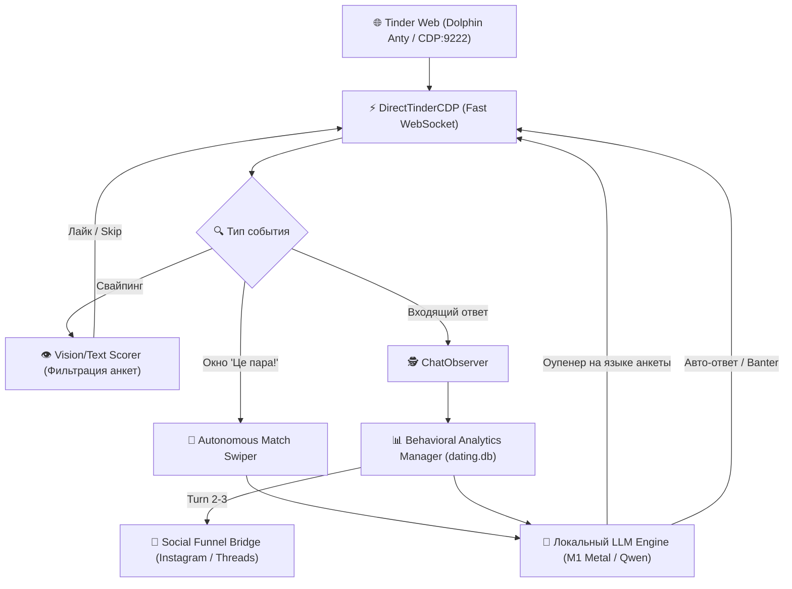

# 🏹 Cupid Scout AI — Autonomous Matchmaker & Conversational Dating Agent

> **Статус проекта: 🏁 v1.0.0 Feature-Complete (Production Ready / Финализирован)**  
> Автономный AI-дейтинг агент и Chrome-контроллер на базе локального LLM/VLM (Apple Silicon Metal / LM Studio), который полностью берет на себя рутину знакомств: свайпает, фильтрует, **общается вместо вас**, ведет остроумный диалог на родном языке девушки и переводит теплые контакты в личные соцсети.

[](https://github.com/JustiS-V/cupid-scout/releases)
[](LICENSE)
[](https://www.python.org/)
[](core/direct_tinder_cdp.py)

---

## 🌟 Ключевые возможности: Что умеет агент

### 1. 🤖 Автономное общение вместо вас (Autonomous Conversational AI)
Больше не нужно вручную сидеть в приложении и придумывать первые фразы:
* **Мгновенный перехват мэтчей:** в цикле свайпинга при появлении окна «Це пара! / It’s a Match!» агент моментально перехватывает событие.
* **Генерация контекстных оупенеров:** анализирует фото, текст био, хобби и цели знакомства, создавая легкое, цепляющее сообщение без банальщины и пикап-клише.
* **Автономное ведение диалога (Banter & Flirt):**
  * Мониторит входящие ответы через фоновый `ChatObserver`.
  * При получении ответа рассчитывает время задержки ($\Delta t$), эмоциональный тон и интерес.
  * Генерирует остроумный ответ через локальную LLM (`qwen2.5-3b-instruct` / Metal GPU) и автоматически отправляет его в чат.
* **Человеческая моторика печати (Human Typing):**
  * Посимвольный ввод текста со случайными задержками (40–120 мс на клавишу).
  * Естественные паузы на знаках препинания (200–450 мс).
  * Нулевой риск детекции автоматизации и теневых банов.

---

### 2. 🌍 Строгое совпадение языка анкеты (Strict Native Language Matching)
Агент общается с девушкой **строго на том языке, на котором написана её анкета**:
* 🇺🇦 **Украинский:** естественный разговорный слог, ирония, современный киевский/львовский контекст.
* 🇬🇧 **Английский:** остроумный native-вайб для экспатов и иностранок.
* 🇪🇸 **Испанский:** легкий, игривый флирт под латиноамериканский/испанский культурный код.
* 🇷🇺 **Русский:** адаптация под язык русскоязычных анкет.

---

### 3. 🧠 Глубокая поведенческая аналитика (Dating Behavioral Intelligence)
Система собирает телеметрию диалогов в SQLite (`dating.db`) и JSONL:
* **Скорость отклика ($\Delta t$):** точное время от нашего сообщения до ее ответа (в минутах и секундах).
* **Коэффициент вклада (Investment Ratio, IR):** соотношение объема символов ее сообщений к нашим. Показывает реальную заинтересованность.
* **Взаимность вопросов:** задает ли девушка встречные вопросы или просто отвечает.
* **Поведенческие архетипы:** автоматическая классификация (`⚡ Fast Responder`, `⚖️ Neutral Chat`, `Ghoster`).
* **Живой отчет:** генерируется в `data/behavioral_analysis_report.md`.

---

### 4. 📲 Перелив аудитории в личные соцсети (Social Growth Funnel)
Агент превращает Tinder в генератор целевых подписчиков для ваших личных каналов:
* **Instagram / Threads / TikTok / Telegram Bridge:** на 2–3 ходу диалога, когда установлен раппорт, бот естественно предлагает перейти в Instagram или Threads.
* **Social Leads Harvester:** автоматически извлекает никнеймы `@instagram` из анкет и чатов, сохраняя их в базу `social_leads`.
* **Сводный отчет конверсии:** `data/social_growth_report.md` с воронкой переходов.

---

### 5. 🛡 Автоматическое управление квотами и лимитами
* Отслеживает лимит бесплатных лайков (Free Tier Tinder).
* При появлении платного попапа («Плани передплати Tinder Plus®») бот фиксирует лимит, закрывает модалку и ставит точный таймер кулдауна (12 часов), предотвращая пустые клики.

---

## 🏗 Архитектура системы



---

## 🚀 Быстрый старт

### 1. Установка окружения
```bash
git clone git@github.com:JustiS-V/cupid-scout.git
cd cupid-scout
python3 -m venv venv
source venv/bin/activate
pip install -r requirements.txt
```

### 2. Запуск локального движка LM Studio (Mac Apple Silicon или Windows)
Загрузите модель `qwen2.5-3b-instruct` (или Qwen2.5-VL / media-vision):
```bash
lms server start --port 1234 --cors
```

### 3. Подключение к браузеру
Запустите Google Chrome или профиль Dolphin Anty с открытым портом отладки:
```bash
# Google Chrome
/Applications/Google\ Chrome.app/Contents/MacOS/Google\ Chrome --remote-debugging-port=9222
```
Войдите в свой аккаунт Tinder (`https://tinder.com/app/recs`).

---

## 🛠 Команды CLI (`main.py`)

| Команда | Описание |
| :--- | :--- |
| `python main.py loop --limit 50` | **Полный автономный цикл:** свайпает, при мэтче сразу пишет первое сообщение, возвращается к свайпам |
| `python main.py analytics` | **Поведенческая аналитика:** выводит таблицу времени ответов девушек, коэффициенты вклада и архетипы |
| `python main.py social` | **Воронка соцсетей:** статистика перелива в Instagram/Threads и каталог собранных лидов |
| `python main.py chat` | Генерация и просмотр предложений оупенеров для взаимных мэтчей |
| `python main.py auto-swipe --limit 100` | Фоновый свайпинг до момента срабатывания лимита Tinder Plus |
| `python main.py platforms` | Список доступных проверенных платформ знакомств |
| `python main.py stats` | Сводная статистика по базе анкет и лайков |

---

## 📁 Структура репозитория

```
├── core/
│   ├── direct_tinder_cdp.py      # Мгновенный легковесный WebSocket CDP-клиент
│   ├── autonomous_match_swiper.py # Автономный цикл свайп + авто-первое сообщение
│   ├── chat_observer.py          # Мониторинг ответов девушек и фиксация времени отклика
│   ├── chat_sender.py            # Посимвольная печать сообщений с человеческими паузами
│   ├── chat_generator.py         # Промпты и генерация реплик через локальный LLM
│   ├── analytics.py              # Психолингвистическая и поведенческая аналитика
│   ├── social_funnel.py          # Воронка перелива в Instagram, Threads, TikTok, TG
│   ├── quota_manager.py          # Учет суточных лимитов и кулдауна свайпов
│   └── scorer.py                 # Фильтрация и оценка анкет по правилам
├── social_growth_config.json     # Конфигурация аккаунтов соцсетей и шаблонов перевода
├── platforms.json                # Список разрешенных дейтинг-платформ
├── main.py                       # Главный CLI-интерфейс
└── data/                         # SQLite база (dating.db) и Markdown-отчеты
```

---

## 🔒 Безопасность и этичность

1. **Анти-спам:** Агент никогда не рассылает шаблонный спам или ссылки в первом сообщении.
2. **Защита от банов:** Все клики, тайминги и движения мыши используют рандомизацию интервалов.
3. **Локальная конфиденциальность:** Все текстовые данные и переписки анализируются локально на вашем компьютере (Apple Silicon Metal / LM Studio), без утечки на сторонние облачные серверы.

---

## 🏁 Закрытие репозитория / Transition Note

> **Проект `cupid-scout` полностью финализирован (Release v1.0.0).**  
> Вся кодовая база стабильна, протестирована на реальных сессиях и решает задачу полной автономности в дейтинг-приложениях.  
> Дальнейшее развитие архитектуры переходит в выделенный проект **Social Media AI Agent / Social Autopilot** для масштабирования контента и личных соцсетей (Instagram, Threads, TikTok).
